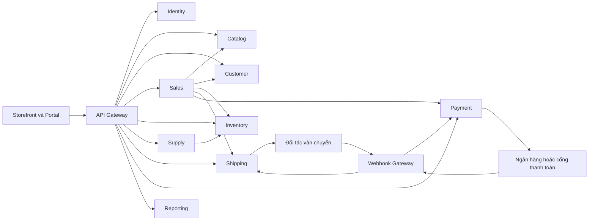

# Kiến trúc và tích hợp

## Phân chia và triển khai

Giữ Angular/NestJS/MySQL theo nền tảng có sẵn. Monorepo, tiến trình dịch vụ độc lập, schema và DB user riêng. Có thể dùng chung máy MySQL ở dev, không cho service truy cập bảng của service khác. Không yêu cầu Kubernetes hoặc message broker cho phiên bản đầu.

| Dịch vụ | Cổng đề xuất | Schema | Sở hữu |
| --- | --- | --- | --- |
| Gateway | 3000 | Không | Route, auth biên, rate limit, webhook ingress |
| Identity | 3001 | xd_identity | User, role, session |
| Catalog | 3002 | xd_catalog | Sản phẩm, đơn vị, giá, ảnh |
| Inventory | 3003 | xd_inventory | Balance, reservation, movement, kiểm kê |
| Sales | 3004 | xd_sales | Giỏ server, quote tổng hợp, order, cancellation, saga |
| Shipping | 3005 | xd_shipping | Báo phí đối tác, vận đơn, hành trình, hoàn vận chuyển |
| Supply | 3006 | xd_supply | Supplier, receipt |
| Reporting | 3007 | xd_reporting | Projection báo cáo |
| Customer mới | 3008 | xd_customer | Hồ sơ và địa chỉ khách |
| Payment mới | 3009 | xd_payment | Attempt, khoản thu, refund, ledger/đối soát COD |

Shared chỉ gồm hợp đồng DTO/schema, mã lỗi, logger, HTTP và auth utility. Không chia sẻ repository/entity persistence rồi đọc DB chéo. Gateway không điều phối giữ kho/thu tiền; Sales là chủ saga đơn. Lựa chọn kỹ thuật: TypeORM + mysql2, migration riêng từng schema, synchronize=false; quyết định và nguồn tại tài liệu 10.

## Đồng bộ và bất đồng bộ

- Tra cứu/quote: HTTP đồng bộ có timeout. Checkout trả 201 nếu đủ điều kiện sẵn sàng hoặc 202 kèm URL theo dõi khi còn bước giữ hàng.
- Mỗi service có outbox cùng transaction ghi dữ liệu; worker gửi HTTP nội bộ có xác thực tới inbox service đích. Delivery là at-least-once, consumer phải idempotent.
- Lệnh có command_id; sự kiện có event_id, type, aggregate_id, aggregate_version, occurred_at, correlation_id, schema_version, payload tối thiểu.
- Inbox unique `(source, event_id)`. Outbox có attempt_count, next_attempt_at, lease_until, last_error, delivered_at; retry backoff và hàng đợi lỗi cần người xử lý.
- Không giả định transaction MySQL ở Sales làm rollback được Inventory/Payment. Ghi saga step và bù nghiệp vụ; tiền đã thu chỉ bù bằng refund.
- Reporting nhận các sự kiện bền vững; có checkpoint, replay idempotent và chỉ số last_synced_at. Không chạy JOIN xuyên schema nghiệp vụ.

## Interface thanh toán cần định nghĩa

`createPayment(orderRef, amount, currency, expiresAt, returnUrl)`, `queryPayment(merchantRef)`, `closePayment(merchantRef)` nếu hỗ trợ, `verifyNotification(rawBody, headers)`, `refund(paymentRef, refundRef, amount)`, `queryRefund(refundRef)`.

Mỗi kết quả chuẩn hóa gồm provider, merchantRef, providerTransactionId, amount, currency, status, providerOccurredAt, rawStatus. Bảo toàn payload cần đối soát dưới chính sách hạn chế truy cập/lưu giữ; không log toàn bộ dữ liệu nhạy cảm.

Checklist chọn đối tác: sandbox, merchant onboarding, cơ chế xác thực/signature chính thức, đơn vị tiền, expiry, callback retry/ACK, truy vấn giao dịch theo mã của cửa hàng, refund toàn phần, query refund, timeout và rate limit. Nếu không có refund API phải thiết kế thao tác hoàn thủ công kèm bằng chứng và hai bước kiểm tra, không giả là đã tự động.

## Interface giao hàng cần định nghĩa

`checkServiceability(address, packages)`, `quote(...)`, `createShipment(orderRef, packages, recipient, codAmount, payer)`, `queryShipment(ref)`, `cancelShipment(ref)`, `requestReturn(ref)` nếu hỗ trợ, `verifyNotification(rawBody, headers)`, `getCodStatement(period)` hoặc import bảng đối soát.

Cần biết: phân vùng địa chỉ/version mã địa bàn, kg/g và cm/mm, giới hạn hàng/xe, số kiện, khai giá, bảo hiểm, phí thu COD, phí hoàn, VAT của dịch vụ, người trả phí, lịch lấy, bằng chứng giao/thu và chuẩn đối soát. Quy đổi về đơn vị chuẩn trong adapter, không truyền nhầm kg thành g.

Vật liệu rời hoặc hàng nặng cần kiểm tra khả năng phục vụ riêng; không gán kích thước giả để lấy phí. Nếu một đơn gồm nhiều kiện nhưng giao một lần, package list phải được đối tác hỗ trợ. Giao outbound nhiều đợt ngoài phạm vi đã chốt. Trả sau giao không bị coi là giao bán đợt hai.

## Webhook

1. Gateway giữ nguyên raw body, chuyển headers cần xác minh, giới hạn kích thước và rate theo đối tác; không parse rồi serialize làm đổi chữ ký.
2. Payment/Shipping xác minh đúng thuật toán/timestamp/chống replay của tài liệu đối tác; không dùng JWT khách cho webhook.
3. Kiểm tra merchant/account, mã tham chiếu, số tiền/tiền tệ khi liên quan.
4. Ghi inbox bền vững; chỉ ACK thành công sau commit. Mã HTTP/body ACK phải theo hợp đồng đối tác, không mặc định một dạng cho tất cả.
5. Worker xử lý, ghi outbox thông báo Sales/Reporting. Thông báo không khớp đưa hàng đợi đối soát.
6. Có worker query bù khi thiếu webhook. Mốc polling, giới hạn và retry chốt theo đối tác.

Không tin eventId do bên ngoài cung cấp nếu chữ ký sai. Nếu đối tác không có eventId, adapter tạo khóa từ tập trường ổn định theo hợp đồng, không hash tùy ý toàn payload có timestamp thay đổi.

## Bảo mật và vận hành

- Xác minh JWT signature/issuer/audience/expiry; không chỉ decode. Access token ngắn hạn đề xuất 15 phút, refresh xoay vòng, lưu hash refresh token; thu hồi session khi logout/khóa/đổi mật khẩu.
- Gateway và dịch vụ kiểm tra quyền/ownership; nội bộ dùng credential riêng, không tin header user-id do trình duyệt tự đặt. Dịch vụ kiểm tra session version để khóa/đổi quyền có hiệu lực ở request kế tiếp.
- Refresh cookie HttpOnly/Secure/SameSite thích hợp, bảo vệ CSRF nếu dùng cookie; access token trong memory. Giới hạn CORS theo frontend thật. Chốt miền triển khai trước cấu hình cookie.
- TLS công khai; không expose port DB/dịch vụ nghiệp vụ ra Internet; secret qua môi trường/secret store, có quy trình đổi khóa.
- Băm mật khẩu bằng thư viện chuyên dụng; login dùng verify với hash đã lưu, không so hash mới có salt ngẫu nhiên.
- Parameterized query, DTO validation, upload ảnh kiểm loại/kích thước và tên file; không cho nhập URL tùy ý để server fetch nội bộ.
- Audit: actor, role, action, entity, before/after cần thiết đã che dữ liệu, result, time, correlation_id. Không log password, JWT, khóa tích hợp hoặc toàn thông tin ngân hàng.
- Health liveness tách readiness DB/outbox; provider outage không nhất thiết làm toàn ứng dụng mất readiness.
- Sao lưu DB tối thiểu hằng ngày, bản sao riêng vị trí, mã hóa/quyền hạn; diễn tập restore trước go-live. RPO/RTO và thời hạn lưu log/bản sao cần chốt theo hạ tầng.
- Mục tiêu p95 <=3 giây cho API thông thường theo đề bài; đề xuất baseline nghiệm thu 20 người dùng đồng thời, 10.000 sản phẩm, 50.000 đơn trên cấu hình ghi rõ. Đây là tải đề xuất, không phải yêu cầu đã xác nhận; callback/checkout async đo riêng, không hứa toàn bộ đối tác hoàn tất trong 3 giây.

## Cấu hình dự kiến

`DATABASE_URL` riêng từng tiến trình; `PORT`, `SERVICE_BASE_URL`, `INTERNAL_AUTH_*`, `JWT_*`, `CORS_ORIGINS`, `PUBLIC_APP_URL`, `PAYMENT_PROVIDER`, `PAYMENT_*`, `SHIPPING_PROVIDER`, `SHIPPING_*`, `CHECKOUT_TTL_SECONDS`, `COD_CONFIRM_TTL_SECONDS`, worker interval/retry. Giá trị bí mật không đưa vào docs hoặc git. Adapter mock phải có cờ môi trường và bị cấm trong production readiness.
