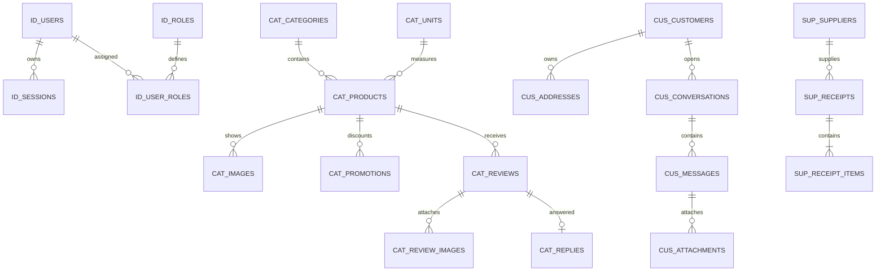
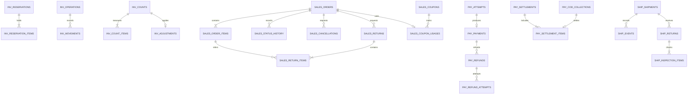
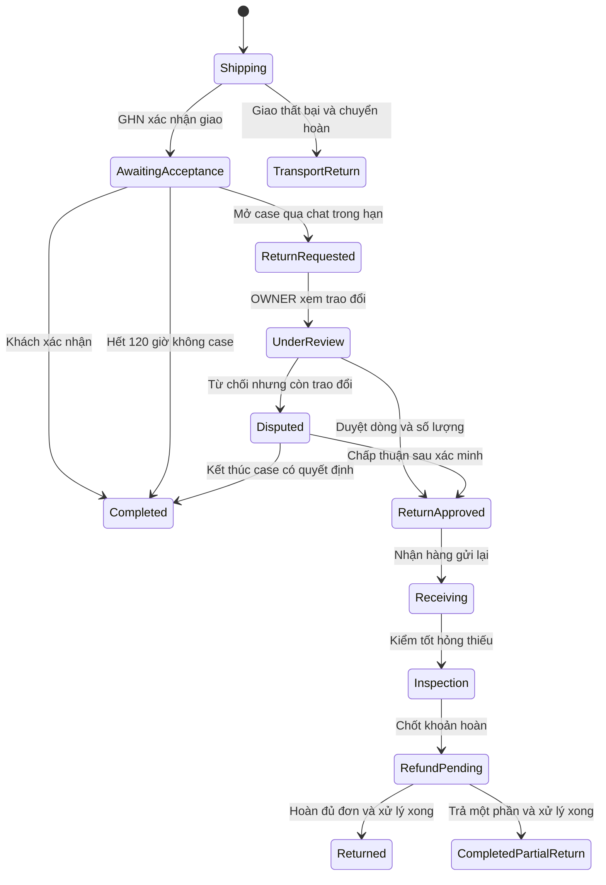
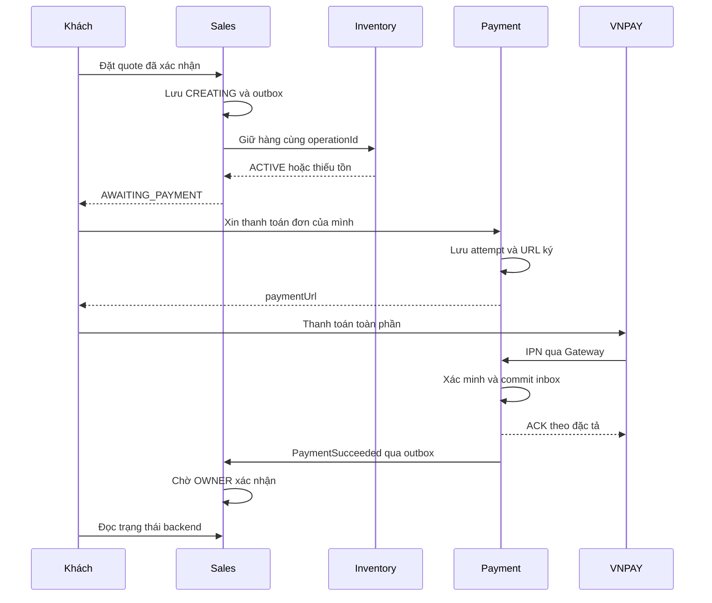

# Sơ đồ và quyết định kỹ thuật

## Lựa chọn để bắt đầu code

Giữ stack trong repository: Angular, NestJS, TypeScript, MySQL. Đề xuất TypeORM + mysql2 cho persistence, Nest integration qua `@nestjs/typeorm`; migration riêng từng datasource và `synchronize=false` trong mọi môi trường dùng dữ liệu cần giữ. Tài liệu cơ sở: [Nest database](https://docs.nestjs.com/techniques/database), [TypeORM migration setup](https://typeorm.io/docs/migrations/setup/). Đây là lựa chọn thiết kế, chưa cài dependency hoặc viết implementation.

Khi bắt đầu P01, chọn phiên bản package tương thích với Nest/Node thực tế, khóa lockfile và chạy build; không lấy version mới nhất mà không kiểm tra. Bổ sung validation, decimal arithmetic, password hashing, JWT, OpenAPI, WebSocket và test runner theo module; không cài trước mọi thư viện chưa dùng. Không tự nâng Angular/Nest trong công việc chuẩn bị tài liệu này.

Chat: WebSocket với REST recovery, DB lưu message. Outbox/inbox: worker trong từng tiến trình service cho giai đoạn đầu; có lease tránh xử lý trùng, không cần Redis/message broker ngay. Media: interface storage, local directory private ở dev và storage riêng ở production; không đặt ảnh chat private dưới thư mục public của Angular.

Login đề xuất email + password, SĐT nhận hàng là contact. Khôi phục mật khẩu tự phục vụ cần email provider/token one-time; khi chưa tích hợp email, chỉ OWNER reset tài khoản kho và ADMIN reset OWNER theo quy trình có audit. Không quảng cáo chức năng “quên mật khẩu khách hàng” nếu chưa có kênh xác minh an toàn.

## ERD theo ranh giới sở hữu

Sơ đồ chỉ thể hiện quan hệ nội bộ; `product_id`, `order_id`, `user_id` chéo dịch vụ là tham chiếu logic, không tạo FK xuyên schema. Các trường đầy đủ nằm trong tài liệu 05/08.





Order reference trong Payment/Shipping không vẽ cạnh FK đến Sales để tránh hiểu nhầm DB join. Dòng review có `order_item_id` là tham chiếu eligibility, cũng không FK xuyên schema.

## Sơ đồ sau giao



Các nhãn ngắn trong sơ đồ là tên trình bày; mapping enum dùng tài liệu 03/08. Trả hàng được duyệt nhưng không nhận được hàng không tự chuyển refund; mở ngoại lệ xử lý.

## Sơ đồ thanh toán online



Return URL trình duyệt có thể đến trước IPN; giao diện hiển thị đang kiểm tra, không tự chuyển PAID. Mũi tên outbox là delivery có retry/idempotency, không khẳng định transaction xuyên service.

## Cấu trúc code dự kiến

```text
backend/services/<service>/src/
  main.ts
  app.module.ts
  modules/<business-module>/
    *.controller.ts
    *.service.ts
    dto/
    entities/
    repositories/
backend/shared/
  bootstrap.ts
  service-http.ts
  health/
frontend/<app>/src/app/
  core/               # API/auth/interceptor
  shared/             # UI không chứa quyền nghiệp vụ nguồn
  features/           # module nghiệp vụ theo tài liệu 02
```

Không bắt buộc tạo thư mục rỗng. Tạo khi triển khai module có trách nhiệm cụ thể. Customer/Payment mới cần đăng ký launcher, config port, build và readiness; script start hiện tại chưa tự nhận service mới.

## Lát cắt đầu tiên nên code

P01–P06: MySQL datasource + migration Identity, lỗi/validation, auth bốn vai trò, Gateway chuyển tiếp danh tính an toàn, đăng nhập trên frontend và kiểm tra ownership. Sau đó P07–P12: Catalog → tồn đầu kỳ → phiếu nhập → kiểm kê. Chỉ chuyển sang checkout khi tồn được lưu thật và các phép giữ/xuất có transaction.

Không viết toàn bộ schema mới rồi kết luận dự án hoàn tất. Mỗi lát cắt có API contract hoàn chỉnh trong OpenAPI, persistence, UI và kiểm thử theo tài liệu 07; các contract markdown hiện là thiết kế đầu vào cho bước đó.
